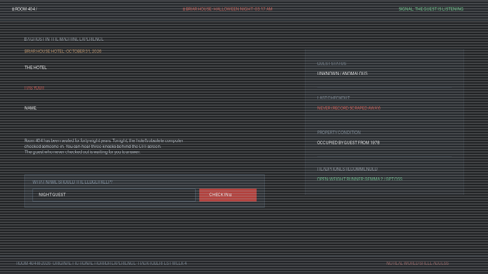

# Room 404

**The hotel has your name.** Room 404 is an interactive haunted terminal experience built for the [Hacktoberfest 2026 Week 4 “Ghost in the Machine” challenge](https://dev.to/challenges/hacktoberfest-week4-2026-10-26).

On Halloween night, 2026, you enter an abandoned hotel whose obsolete management computer (BriarOS v4.04 on PDP-11) still holds the trace of a guest from October 31, 1978. Explore four rooms, inspect corrupted sector files, converse directly with the entity inhabiting the machine, and answer the knocks behind the screen. An open-weight **Google Gemma 2 (`gemma2-9b-it`)** model running on Groq narrates the ghost—crafting the prose, whisper, and typed visual manifestations (flicker, shadow, knock, mirror reversal, or signal static)—while deterministic domain rules govern the world invariants, clue discovery, and fear meter.



[See the game screen](docs/demo/game.png) · [Read a sample transcript](docs/demo/sample-transcript.md)

---

## What Makes This a True "Ghost in the Machine"

The Hacktoberfest Week 4 challenge prompt calls for:
> *“A haunted terminal that 'possesses' your shell and whispers back eerie commentary on the commands you run”*

Room 404 delivers this across two interactive experiences:
1. **Interactive Web CRT Ghost Terminal & CCTV Console**:
   * Switch seamlessly between **⌨ GHOST TERMINAL** (a possessed PDP-11 command line) and **📹 CCTV CONSOLE** (visual surveillance cameras & choice cards).
   * Run real system commands: `ls`, `cat <file>`, `cd <sector>`, `whoami`, `status`, `dial 404`, and `knocks`.
   * Type any freeform phrase to address the entity directly through the machine.
   * As you interact, the ghost corrupts system outputs with glitched text, audio frequency drops, and visual CRT flickers.
2. **Real Shell CLI Mode (`npm run haunt`)**:
   * Run a real possessed terminal directly in your macOS/Linux shell (`zsh`/`bash`).
   * Takes over your terminal window with retro ANSI borders, runs interactive commands, and streams eerie Gemma 2 AI whispers into your prompt.

---

## Why Google Gemma 2 & Open-Weight Innovation Matter

1. **Freedom from Corporate Content Filters**:
   Commercial closed-source APIs frequently over-censor psychological horror, spooky fiction, and atmospheric ghost stories due to blunt commercial safety filters. Serving Google's open-weight **Gemma 2 (`gemma2-9b-it`)** on Groq allows genuine creative exploration of psychological dread with strict, structured output boundaries.
2. **Deterministic Rules vs. Generative Haunting**:
   Horror loses its tension if an AI can hallucinate whatever it wants. In Room 404, the AI cannot invent rooms, alter historical records, or prematurely unlock an ending. Deterministic domain code owns the hotel facts and ending gates; Gemma 2 brings the machine's voice and visual interference to life.
3. **Sub-Second Low Latency Inference**:
   Running Gemma 2 on Groq delivers instant token generation, making terminal commands feel snappy and responsive like a real 1970s hardware terminal.

---

## Terminal Commands Reference

| Command | Description |
| :--- | :--- |
| `help` / `?` | Displays the BriarOS command directory |
| `ls` / `dir` | Lists files and logs in the current sector |
| `cat <file>` | Inspects and decrypts sector records (e.g., `cat ledger_1978.log`) |
| `cd <sector>` | Navigates between hotel sectors (`lobby`, `hallway`, `suite`, `basement`) |
| `whoami` | Inspects your registration record in the hotel ledger |
| `status` / `pulse` | Reports your current vital fear level and discovered evidence |
| `dial 404` | Tests the dead telephony line connected to Suite 404 |
| `knocks` / `answer` | Answers the three knocks (inside Room 404 with all 4 records found) |
| `talk <phrase>` | Speaks directly to the ghost inhabiting the wires |
| `clear` | Clears terminal screen buffer |

---

## Architecture & Codebase Layout

```text
room-404/
├── api/                             # Express 5 modular backend (TypeScript)
│   └── src/
│       ├── haunt-cli.ts             # Standalone possessed terminal CLI shell
│       ├── app.ts                   # Express composition, CORS & error boundary
│       ├── server.ts                # HTTP listener entrypoint
│       ├── shared/config.ts         # Environment validation (Gemma 2 on Groq)
│       └── modules/haunting/
│           ├── domain/              # Invariant rules, constants, and lore
│           │   ├── constants.ts     # Central game limits and thresholds
│           │   ├── game.ts          # State transitions and output validation
│           │   ├── terminal.ts      # Room file definitions and sector records
│           │   └── world.ts         # Authored rooms, clues, and action graph
│           ├── application/         # Orchestration service & terminal executor
│           ├── infrastructure/      # Groq Gemma 2 narrator & file repository
│           └── http/                # Request validation router
└── web/                             # Next.js 16 frontend (TypeScript)
    ├── app/                         # App Router layout & page orchestrator
    ├── components/                  # Modular UI components
    │   ├── GhostTerminal.tsx        # Interactive PDP-11 CRT terminal component
    │   ├── Header.tsx               # Status indicator & sound toggle
    │   ├── LandingView.tsx          # Guest check-in & lore card
    │   ├── StoryPanel.tsx           # Narrative, whisper, and action choices
    │   ├── SurveillanceStage.tsx    # CCTV viewport & glitch display
    │   ├── CasePanel.tsx            # Evidence viewer, pulse meter, floor map
    │   ├── ClueModal.tsx            # Document inspection modal
    │   └── Footer.tsx               # Project metadata
    ├── constants/game.ts            # UI limits, timings, and floor metadata
    ├── hooks/                       # Custom audio & session lifecycle hooks
    └── types/game.ts                # Strongly typed domain interfaces
```

---

## Quickstart

### Prerequisites
- Node.js 20+
- A [Groq API key](https://console.groq.com/keys) (powers Gemma 2)

### 1. Configure the Backend

```sh
cd api
cp .env.example .env
# Set GROQ_API_KEY=your_key_here in api/.env
# Default model: GROQ_MODEL=gemma2-9b-it
npm install
npm run dev
```

### 2. Start the Web Frontend

```sh
cd web
npm install
npm run dev
```

Open `http://127.0.0.1:3000` in your browser. Toggle between **⌨ GHOST TERMINAL** and **📹 CCTV CONSOLE** at any time.

### 3. Run the Standalone Shell CLI (Optional)

You can also run the haunted terminal directly inside your actual terminal shell:

```sh
cd api
npm run haunt
```

---

## Verification & Testing

```sh
# Run backend tests (including terminal commands), typecheck, and build
cd api
npm test
npm run typecheck
npm run build

# Verify frontend build
cd ../web
npm run build
```

---

## Challenge Category Entries

Built for **Hacktoberfest 2026 Week 4: Ghost in the Machine** (#hf26challenge):
- **Overall Winner Track**: Atmospheric haunted terminal experience bridging browser and CLI.
- **Best Use of Gemma ($200 Featured Category)**: Natively designed around Google's open-weight **Gemma 2 (`gemma2-9b-it`)** on Groq.

---

## License

MIT. See [LICENSE](LICENSE).
