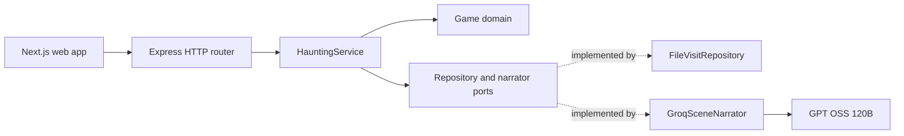

# Architecture

Room 404 has two independently running applications:

```text
room-404/
├── api/                      Express 5, TypeScript, its own package-lock.json
│   └── src/
│       ├── app.ts             composition and HTTP middleware
│       ├── server.ts          one localhost listener
│       ├── shared/config.ts   environment parsing
│       └── modules/haunting/
│           ├── domain/       authored world, state, rules, output validation
│           ├── application/  use cases and explicit ports
│           ├── infrastructure/ Groq and private local JSON adapters
│           └── http/         request validation and routes
└── web/                      Next.js 16, TypeScript, its own package-lock.json
    └── app/                  landing, game, evidence and transcript UI
```

## Dependency direction



The domain does not import Express, Groq, or filesystem code. The application service coordinates a turn through ports. The HTTP router translates requests into use cases. `app.ts` creates the concrete adapters and installs one error boundary.

## Turn lifecycle

1. The router validates the alias, action ID, or short spoken question.
2. `HauntingService` loads the current visit and prevents concurrent actions on the same visit in this single-process app.
3. The domain proposes a transition. It owns the room graph, clue discovery, fear score, and ending gate.
4. The Groq adapter receives only discovered records, the current room, and the last two scenes. It requests strict JSON from `openai/gpt-oss-120b`.
5. The domain validates the model's effect enum, text lengths, evidence IDs, and story invariants. A failed model call or validation leaves the saved visit unchanged.
6. The file repository writes the new visit to a private temporary file, then atomically renames it into place.
7. The web app renders the validated scene and effect. It never sends arbitrary commands to the host.

## Boundaries and limits

- The API binds to `127.0.0.1`; mutating requests with an unrelated `Origin` are rejected.
- `api/.env` holds the Groq key and is ignored by Git. The key is never embedded in Next.js output.
- Request JSON is capped at 4 KB, guest aliases at 24 characters, and spoken questions at 140 characters.
- Only the latest 30 scenes are retained per visit. Files are created with mode `0600` in a private `0700` directory.
- AI chooses prose, whisper, and visual effect; it cannot set a room, clue, fear rule, or ending outcome.
- The game is fictional. A validated citation is evidence of which authored record the model saw, not proof that every sentence is logically entailed by it.
- The local file repository is for one process and one player. Public multi-user hosting would need authentication, tenant isolation, a transactional database, and a rate limit.
